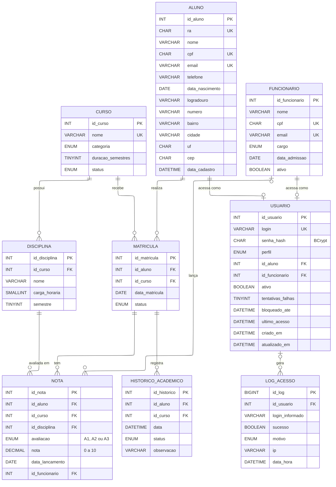

# Diagrama ER — sistema_alunos

## Como ler

- `||--o{` = um para muitos (ex.: um curso possui várias disciplinas).
- `||--o|` = um para zero ou um (ex.: um aluno tem no máximo um usuário de login).
- `|o--o{` = o lado esquerdo é opcional (ex.: uma nota pode ficar sem o funcionário que lançou, se ele for excluído).
- **NOTA** usa chaves estrangeiras compostas: `(id_aluno, id_curso)` aponta para MATRICULA e `(id_disciplina, id_curso)` aponta para DISCIPLINA. Assim a nota só existe se o aluno estiver matriculado e a disciplina for do curso dele.
- **HISTORICO_ACADEMICO** aponta para MATRICULA por `(id_aluno, id_curso)`.
